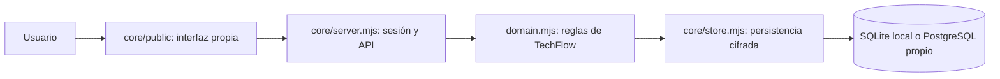

# Diseño · TechFlow

Sistema autónomo para recepción, clasificación, almacenamiento, notificación, auditoría y revisión manual. Su código y datos están contenidos en esta carpeta.

## Arquitectura

No hay imports del proyecto vecino ni dependencias de la carpeta superior. server.mjs arranca únicamente TechFlow. core/ contiene una copia mantenida por este proyecto de sus utilidades técnicas; no es un paquete compartido en ejecución.

## Datos y seguridad

Los datos locales se crean en data/app.sqlite y data/.key. PostgreSQL y sus volúmenes pertenecen a este proyecto. Se usa un agregado JSON cifrado con AES-256-GCM; la integridad de sus entidades se valida en domain.mjs. Se conserva la limitación de una instancia de servidor por proyecto. Las contraseñas usan scrypt y sal, sesiones con expiración, CSRF y permisos en backend.

## Interfaz y negocio

Roles: admin, gestor y consulta. Pantallas: resumen documental, archivo, revisión, flujos, notificaciones, reportes, auditoría y cuenta. Los archivos TXT/PDF de hasta 1 MB se clasifican por nombre/asunto. Los desconocidos y ambiguos van a revisión; SHA-256 evita duplicados. El frontend usa una identidad violeta y un símbolo documental. n8n coordina cinco workflows propios cuando se configura Docker.

## Verificación

24 verificaciones automatizadas aprobadas en este proyecto. Se comprobó además el arranque, login, API y frontend desde una copia aislada sin el otro sistema. Docker/n8n/TLS y la revisión visual siguen requiriendo validación del entorno. No se declara TRL 5 sin usuarios y evidencias reales.
